# CDNCA

**CDN 节点、插件超市，一台主控运营 CDN 平台。**  
**市场能力随版本开放。**

CDNCA 是独立的开源核心（open-core）CDN 平台，控制面与边缘数据面均为自研。

社区版可自托管、**免激活**、无内置计费。官网：[https://cdnca.com](https://cdnca.com)

> English (short): CDNCA is an independent open-core CDN platform (Go control plane + edge nodes). Community Edition is free to self-host with no activation. Tagline: *CDN nodes, plugin marketplace — one control plane to run your CDN platform.* Marketplace features roll out by version. Site: https://cdnca.com

---

## 简介

装一台 CDNCA 主控，即可运营自己的 CDN：

- **节点**：可自建，也可在节点市场订阅供货商节点（供货商可按天 / 按 G / 按带宽 / 95 等自定计价）
- **插件**：官方与开发者可上架的插件超市（随版本开放）
- **社区版**：开源可自托管 · 完全免费 · 免激活 · 无内置套餐/支付

**市场能力随版本开放。** 请勿理解为「今日全站已可挂货交易」。

---

## 四个端，各管一摊

一台主控同时提供管理端（平台运营）和用户端（租户自助）两套界面，边缘节点由主控统一下发配置，市场入口内置在管理端里。

> 下面的截图来自前端加模拟数据（域名、IP 均为文档保留地址），数字只用于展示界面，不代表性能或运营数据。截图脚本：`scripts/ui/readme-shots.mjs`。

### 管理端（平台运营）

给 CDN 平台的运营者用：节点、线路、网站、安全策略和统计都在一个后台里。

- **一页看全平台**：运营数据、带宽峰值、请求数、拉黑 IP 数、主控 / 分析服务 / Agent 状态和 TOP10 排行集中在服务概览
- **节点集中管理**：节点列表直接显示区域、线路组、实时带宽、月流量和 XDP 过滤状态；支持待初始化、同步失败自动禁用和区域管理
- **全平台网站一览**：按租户、分组、线路组查看所有网站的 CNAME、HTTPS、源站与监听端口，批量修改、批量申请证书
- **规则统一下发**：WAF 规则库分平台规则和租户规则，平台规则可订阅、可更新，也可以只对指定用户显示
- **实时监控**：带宽、流量、访问次数、QPS，以及质量监控与回源监控

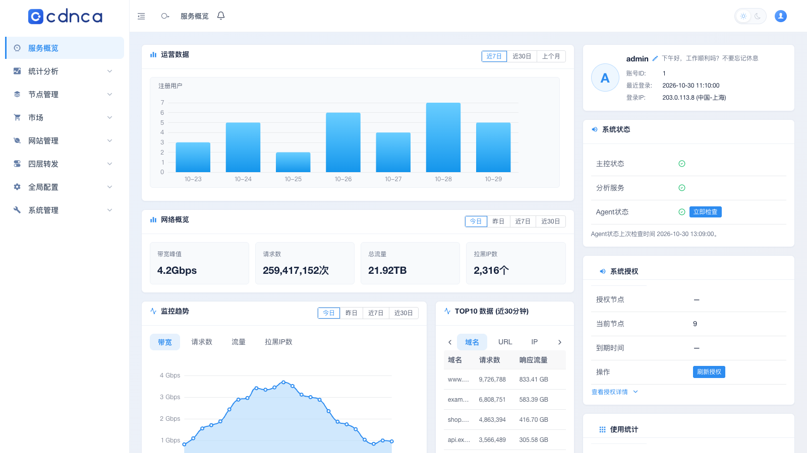

| 节点列表 | 网站列表 |
|---|---|
| 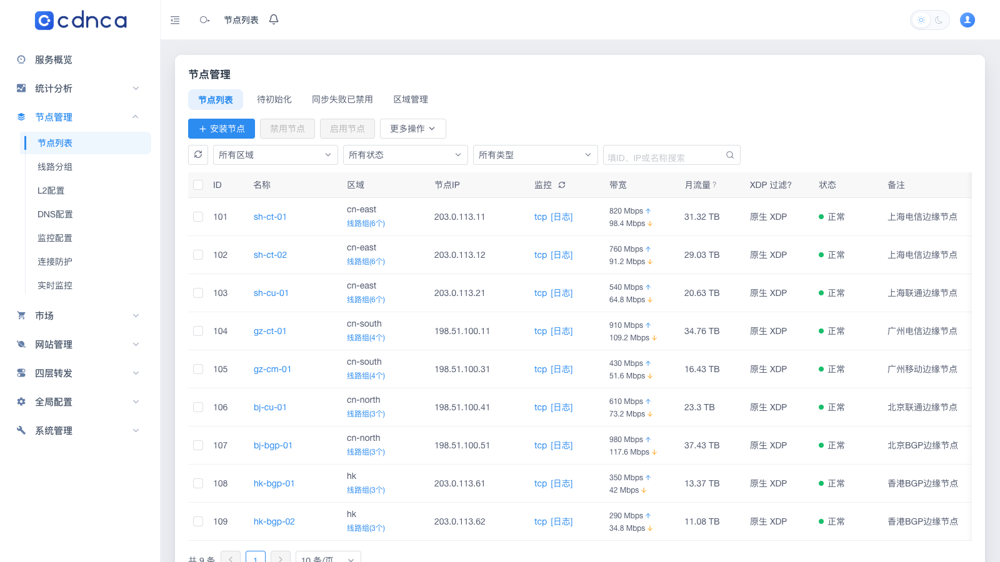 | 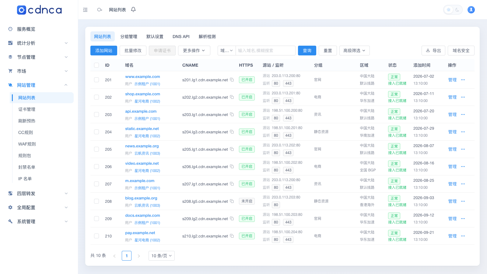 |
| **WAF 规则库** | **实时监控** |
| 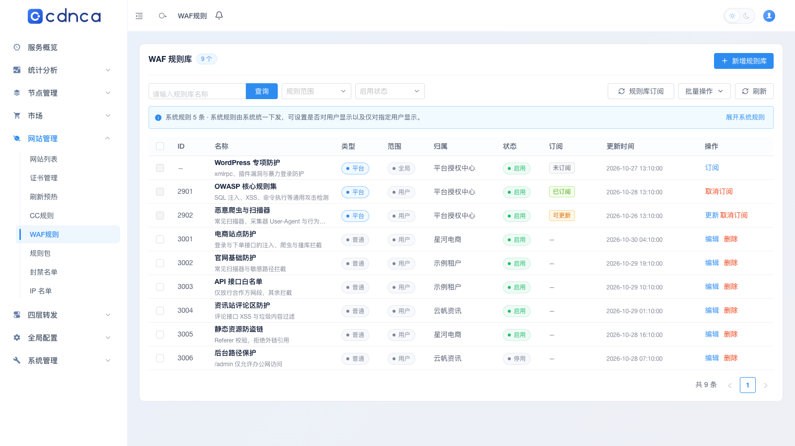 | 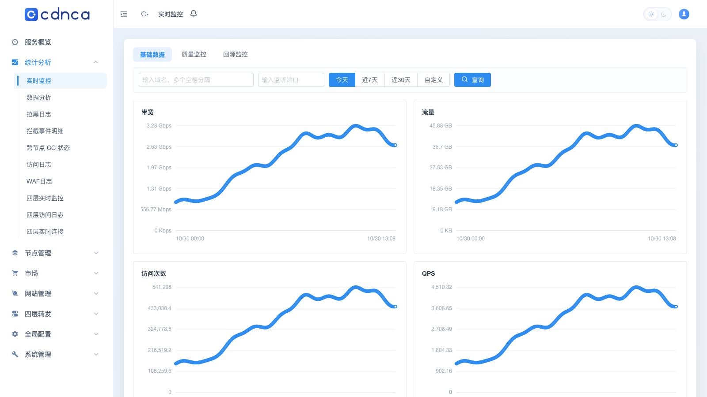 |

### 用户端（租户自助）

给平台的客户用：接入、配置、排障都能自己完成，不用找运营。

- **接入状态一眼可见**：网站详情顶部逐项检查套餐、线路、CNAME、域名解析、HTTPS 证书、是否已发布到节点，哪一步没通过直接标出来
- **配置按页签分好**：回源、HTTPS、缓存、CC 防护、WAF 防护、自动防御、高级设置，多个访问域名可批量粘贴，中文域名自动转 Punycode
- **多家 DNS 统一管理**：阿里云、Cloudflare、DNSPod、华为云等账号下的域名放在一处，记录实时读取，修改直接写入并回读确认；本平台在用的 CNAME 记录会单独标出
- **数据自己查**：域名排行、热门 URL、TLS 指纹、客户端 IP、国家 / 省份 / 运营商、浏览器与操作系统分布、热门 Referer，缓存命中率和安全事件数一并给出

| 服务概览 | 网站配置与接入检查 |
|---|---|
| 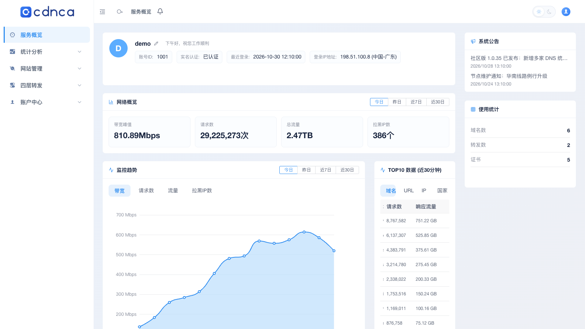 | 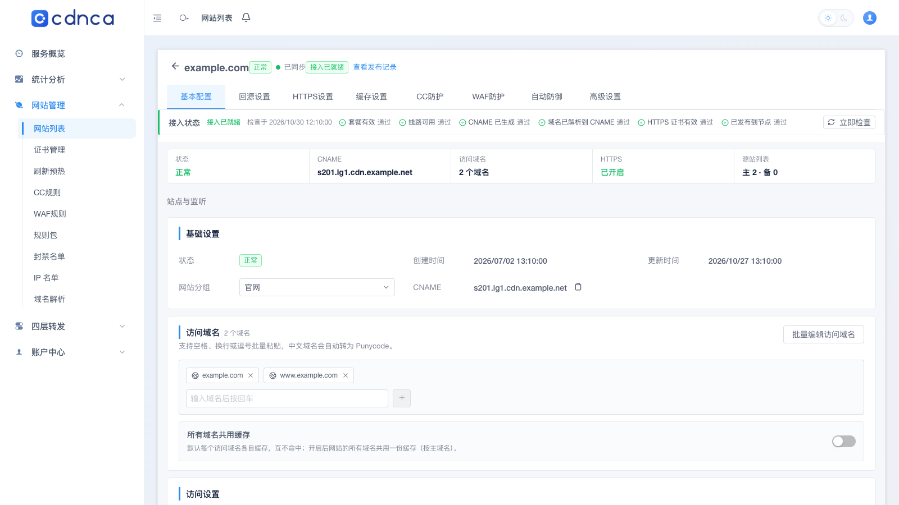 |
| **多家 DNS 统一解析** | **数据分析** |
| 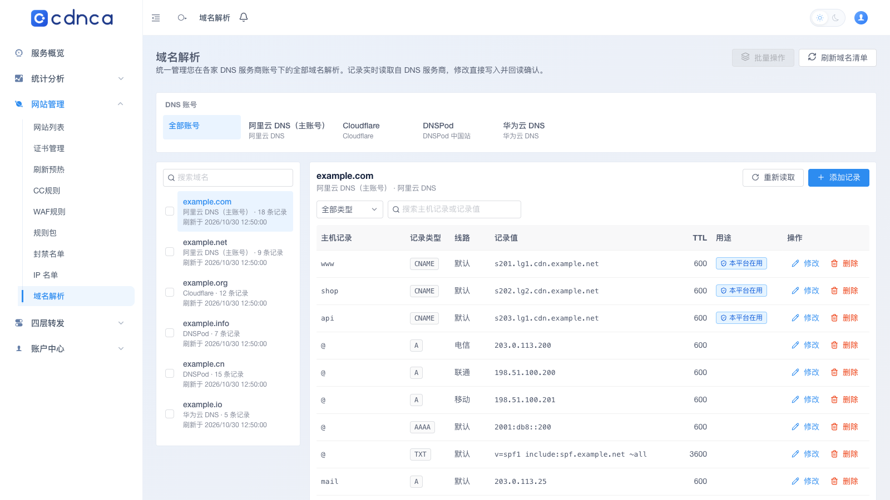 | 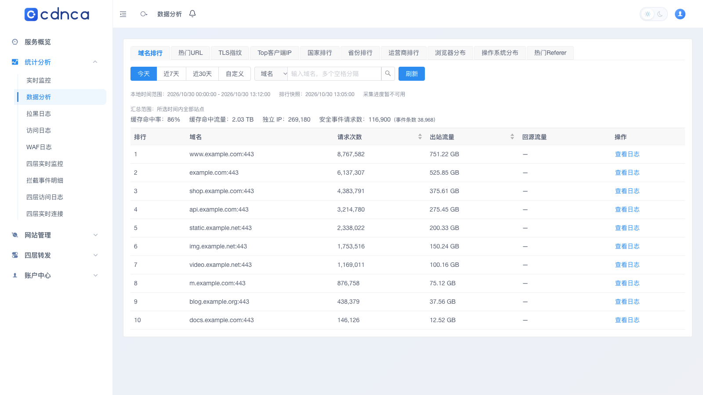 |

### 节点（边缘）

节点由 Go 写的 `edge-agent` 加 OpenResty 边缘运行时组成，主控只负责下发，流量不经过主控。

- **主控下发、节点执行**：网站、证书、缓存、WAF / CC 规则、四层转发都由主控编译后下发，节点回报生效版本；发布失败的节点自动禁用，不会带着旧配置继续接流量
- **原生运行时**：OpenResty 1.31.1.1 从源码构建并打上自带补丁（含 JA4 指纹采集、HTTP/3），节点包和容器镜像同源
- **内核层防护**：XDP 丢包、按站点封禁、TCP 异形包过滤、四层防护规则，攻击流量在进入 OpenResty 之前就被挡掉
- **四层转发**：TCP / UDP 转发、端口范围、四层会话日志和实时连接
- **证书按需加载**：节点证书库不设固定上限，ACME HTTP-01 / DNS-01 自动签发
- **节点接入安全**：一次性注册令牌 + 双向 TLS，节点证书绑定节点 ID，不使用长期共享密钥；网关断开后自动退避重连

节点的运行状态在管理端「节点列表」和「实时监控」里查看（见上方截图）。

### 市场（节点 / 插件，**市场能力随版本开放**）

- **节点市场**：其他主控可以把节点组上架供货，本站按地区、线路、计费方式（按天、按流量、按带宽、95 计费等）挑选订阅；充值直接付到供货方自己的收款账户。本机节点组也可以上架供货
- **插件商店**：规则包、主题、DNS 接入等插件统一在这里获取、购买和启用；每份购买只绑定本主控，经官方签名的按安装制品目录下发
- 社区版需免费注册一次安装身份才能连接市场：`control-api community-register`

| 节点市场 | 插件商店 |
|---|---|
| 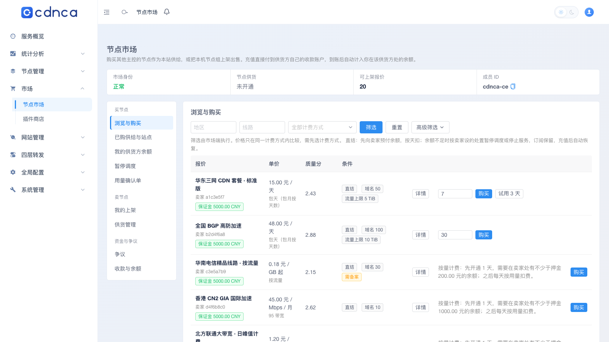 | 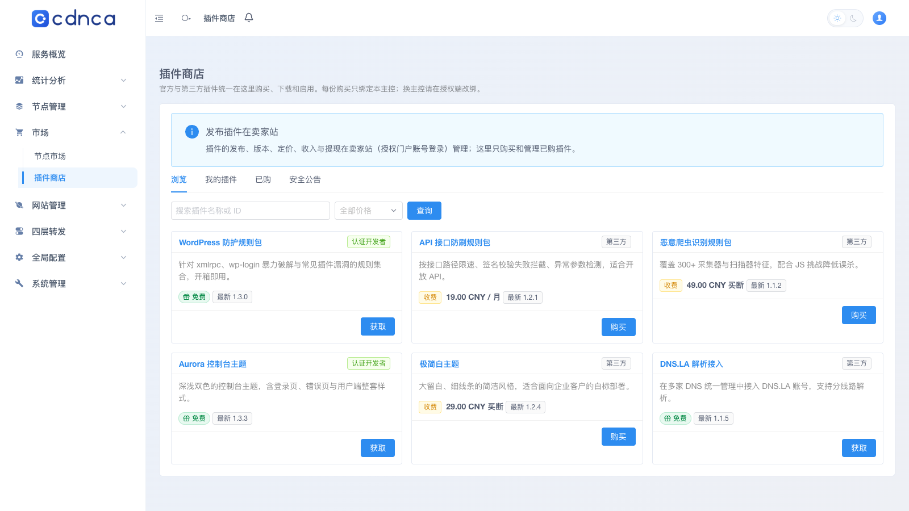 |

---

## 社区版包含

- 网站、域名、证书（含 ACME HTTP-01/DNS-01）、回源、缓存、清缓存与预热
- 节点、线路组、四层转发、节点监控
- 多家 DNS 服务商的域名解析统一管理
- WAF、CC 防护、ACL、JS 挑战、规则包引擎（自建规则包）、快速屏蔽
- 站点自动防御：CC 自动切换、WAF 攻击自动封禁、WAF 命中自动封禁
- 租户与用户管理、工单、通知
- 访问日志、安全日志、CC 统计与分析（ClickHouse）
- 平台节点安全事件（DDoS / 四层防护触发）进通知中心
- 默认主题
- 内置免费模块：短信（阿里云、SUBMAIL）、邮件（阿里云、SendGrid）、备案查询、IP 情报更新、dnspup 拨测
- 可连接节点市场与插件市场购买规则包、主题和插件：需免费注册安装身份，购买后经官方签名的按安装制品目录下发并生效（**市场能力随版本开放**）

## 社区版与商业版

| | 社区版 | 商业版 / 收费模块 |
|--|--------|-------------------|
| 开源控制面 / 自建节点 | ✅ | ✅ |
| 免激活 · 无内置计费 | ✅ | — |
| 节点市场（供货商订阅） | 随版本开放 | 以产品为准 |
| 插件超市 | 随版本开放 | 以产品为准 |
| 商业模块 / 合同级支持 | ❌ | ✅ |

商业模块的代码不在本仓库，包括：智能自动防御与自适应 WAF、攻击自动升级、聚合边缘（对接第三方 CDN）、迁移导入；套餐、余额、充值、订单、流量包、分销、在线支付与财务系统对接；官网前台、额外主题与白标；授权服务、插件市场卖家端、在线升级。官方规则集（高级 CC 规则组、OWASP CRS 档位、自研检测规则集）社区版可在插件市场购买。

社区版适合想先跑通、自托管的个人、小团队与 CDN 商。需要合同级支持或商业模块时，请通过官网了解（具体条款以正式说明为准）。

社区版不连接授权服务：社区授权内置在程序里，基础功能和配额不限。主控在安装后向官方匿名上报一次安装信息（安装 ID、版本、节点数、站点数），之后每 7 天一次，可以用 `COMMUNITY_REPORT_URL=off` 关闭。社区版没有在线升级，升级时换用新版本的程序包。数据库结构与商业版相同，升级到商业版只需更换程序包。

---

## 架构（主控 + 节点）

| 层级 | 说明 |
|------|------|
| **主控（控制面）** | Go 实现；站点、节点、策略与运营入口，管理端与用户端 Web |
| **节点网关** | 节点注册与 gRPC 通道 |
| **边缘节点（数据面）** | Go 实现的节点 Agent + OpenResty 边缘运行时；缓存、回源与边缘执行 |

```
[ 操作者 ]
    │
    ▼
[ CDNCA 主控 · Go 控制面 ]
    │
    ├── 自建边缘节点（Go）
    └── 节点市场 · 供货商节点（随版本开放）
```

| 路径 | 内容 |
|---|---|
| `services/control-api` | 主控 API、后台任务、数据库迁移 |
| `services/agent-gateway` | 节点注册与 gRPC 通道 |
| `agents/edge-agent` | 节点 Agent（发布应用、日志、遥测、四层、内核防护） |
| `edge/openresty` | 边缘 Lua 模块与原生补丁 |
| `apps/web` | 管理端与用户端前端 |
| `libs/` | 共享库（边缘配置、规则包、授权数据结构、主题） |
| `proto/` | 主控、网关、节点之间的协议 |
| `docs/` | 架构、协议契约、开发者文档、ADR |

---

## 快速开始

安装包将在 GitHub Release 与官网发布，详见 [cdnca.com](https://cdnca.com)。

全新单主控安装使用 `scripts/install-control.sh`（以 root 执行，`--help` 查看参数），不需要激活码。整包和节点包从 `--release-server` 指定的发布站下载并校验签名，也可以用 `--native-package-file` / `--native-trust-file` 指定本地文件。步骤见[安装指南](docs/installation-guide.md)。

**路径 A · 自建节点**

1. 部署社区版主控
2. 安装并注册至少一台自建节点
3. 添加站点，验证缓存与回源

**路径 B · 节点市场订阅（轻资产）**

1. 部署社区版主控
2. 用免费的门户账号注册一次本机安装：`control-api community-register --account <门户账号> --password-stdin`
3. 在节点市场选择供货商并订阅（**市场能力随版本开放**），绑定域名并验证命中

---

## 本地开发

依赖：Docker（含 Compose v2）、GNU Make、Go（见 `go.work`）、Node.js 与 pnpm、Bash、curl、OpenSSL。

```sh
make help
make up
make status
```

`make up` 会启动 PostgreSQL、Redis、ClickHouse、NATS JetStream、数据库迁移、`control-api`、`agent-gateway`、Mailpit 和管理端 Web。本地密钥材料生成在仓库外。只启动基础设施：`make infra-up`、`make infra-test`。

运行测试：

```sh
go -C services/control-api test ./...
go -C agents/edge-agent test ./...
pnpm -C apps/web test
```

部分集成测试需要本地 PostgreSQL，没有时会跳过。

文档：[开发者入口](docs/developer/README.md) · [协议契约](docs/protocol-contracts.md) · [OpenAPI](api/openapi/v1) · [架构决策记录](docs/adr)

---

## 参与贡献

欢迎 Issue、讨论与文档改进。贡献指南将随社区版仓库完善。

提交前请注意：

- 对外表述须带 **「市场能力随版本开放」**（凡涉及节点/插件市场）
- 重大行为与许可证变更须经维护者确认

---

## 许可证

本仓库以 **GNU Affero General Public License v3.0（AGPL-3.0）** 授权，全文见根目录 [`LICENSE`](./LICENSE)。

简要含义：你可以自由使用、修改与再分发；若修改后通过网络对外提供服务，必须按 AGPL-3.0 第 13 条向使用者提供对应的完整源代码。

---

## 链接

- 官网：https://cdnca.com
- 本仓库：https://github.com/CDNCA/cdnca
