# CDNCA

<p align="right"><a href="README.md"></a> <a href="README.zh-CN.md"></a></p>

**CDN nodes and a plugin marketplace: run a CDN platform from one control plane.**  
**Marketplace features roll out by version.**

CDNCA is an independent open-core CDN platform. Both the control plane and the edge data plane are built in-house.

The Community Edition is self-hosted, needs **no activation**, and has no built-in billing. Website: [https://cdnca.com](https://cdnca.com)

---

## Overview

Install one CDNCA control plane and run your own CDN:

- **Nodes**: run your own, or subscribe to supplier nodes on the node marketplace (suppliers set their own pricing: per day, per GB, per bandwidth, 95th percentile, and so on)
- **Plugins**: a plugin marketplace where the official team and developers can list plugins (rolling out by version)
- **Community Edition**: open source and self-hosted · free · no activation · no built-in plans or payments

**Marketplace features roll out by version.** Not every listing or transaction is available today.

---

## Four parts, each with its own job

One control plane serves two web consoles: the admin console (platform operations) and the user console (tenant self-service). Edge nodes get their configuration from the control plane, and the marketplace is built into the admin console.

> The screenshots below come from the frontend with mock data (domains and IPs are documentation-reserved addresses). The numbers only illustrate the UI and are not performance or business data. Screenshot script: `README_SHOTS_LANG=en node scripts/ui/readme-shots.mjs`. The consoles ship in Simplified Chinese, Traditional Chinese and English; switch from the language menu on the sign-in page.

### Admin console (platform operations)

For the people running the CDN platform: nodes, lines, sites, security policies and statistics in one console.

- **The whole platform on one page**: business data, peak bandwidth, requests, blocked IPs, control plane / analytics / agent status and top-10 rankings on the overview
- **Central node management**: the node list shows region, line group, live bandwidth, monthly traffic and XDP filter status; covers pending initialization, automatic disabling after failed syncs, and region management
- **Every site on the platform**: browse all sites by tenant, group and line group with their CNAME, HTTPS, origin and listen ports; bulk edits and bulk certificate requests
- **Rules pushed from one place**: the WAF rule library separates platform rules from tenant rules; platform rules can be subscribed to and updated, or shown only to selected users
- **Real-time monitoring**: bandwidth, traffic, requests, QPS, plus quality and origin monitoring

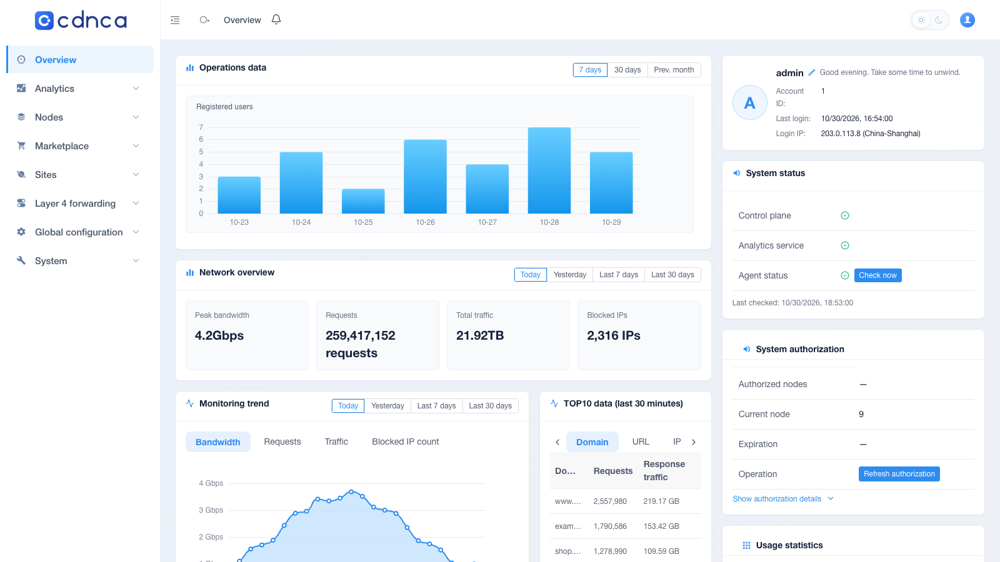

| Node list | Site list |
|---|---|
| 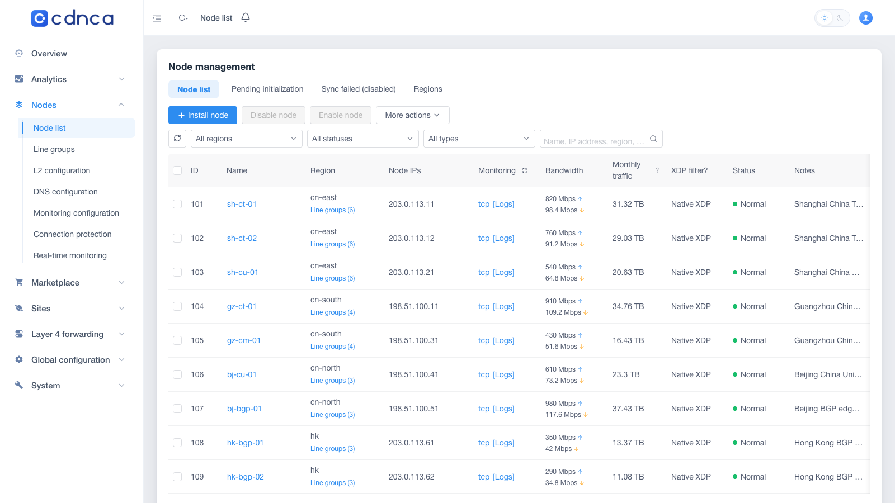 | 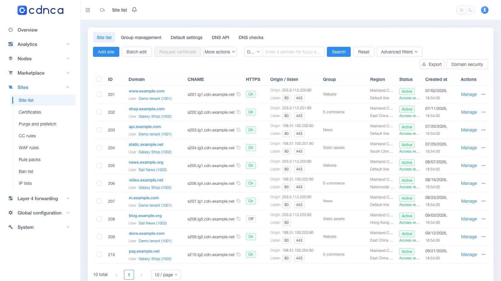 |
| **WAF rule library** | **Real-time monitoring** |
| 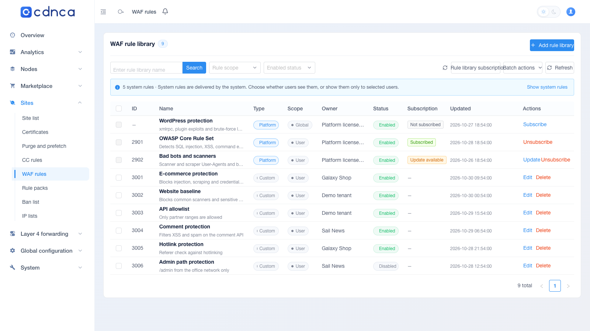 | 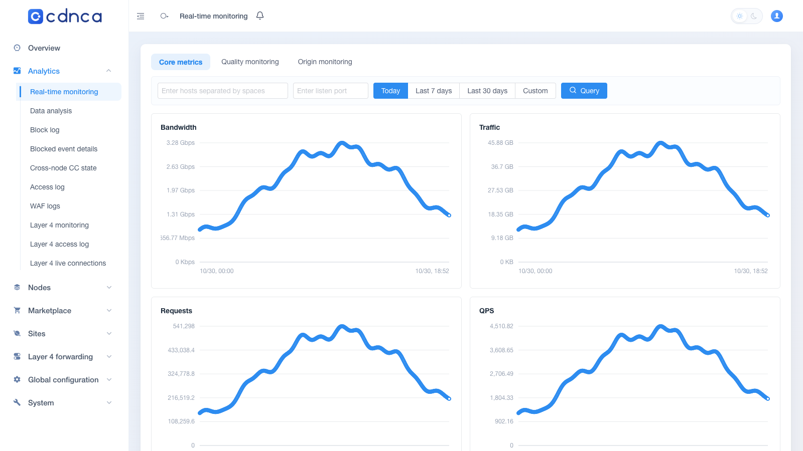 |

### User console (tenant self-service)

For the platform's customers: onboarding, configuration and troubleshooting without opening a ticket.

- **Onboarding status at a glance**: the top of each site checks the plan, line, CNAME, DNS resolution, HTTPS certificate and node publication one by one, and flags the step that failed
- **Settings grouped into tabs**: origin, HTTPS, cache, CC protection, WAF, automatic defense and advanced settings; paste many domains at once, and internationalized domains are converted to Punycode
- **One place for many DNS providers**: domains from Alibaba Cloud, Cloudflare, DNSPod, Huawei Cloud and other accounts in one view; records are read live, changes are written and read back to confirm, and CNAME records used by this platform are marked
- **Analytics on their own**: top domains, top URLs, TLS fingerprints, client IPs, country / province / carrier, browser and OS distribution, top referers, with cache hit ratio and security events

| Overview | Site settings and onboarding checks |
|---|---|
| 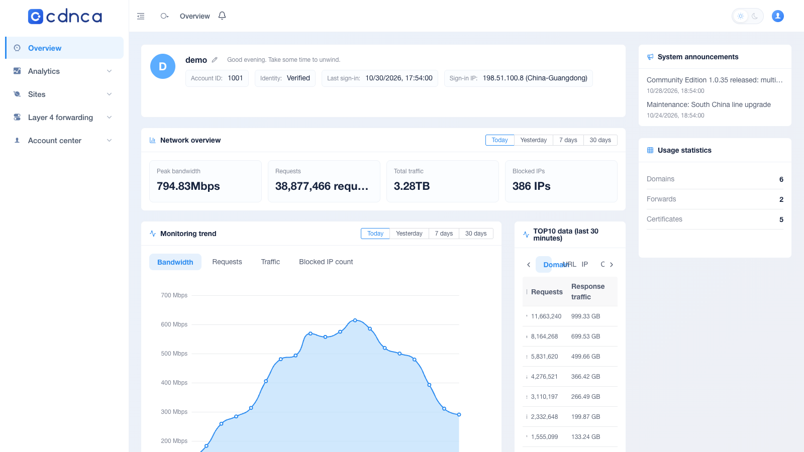 | 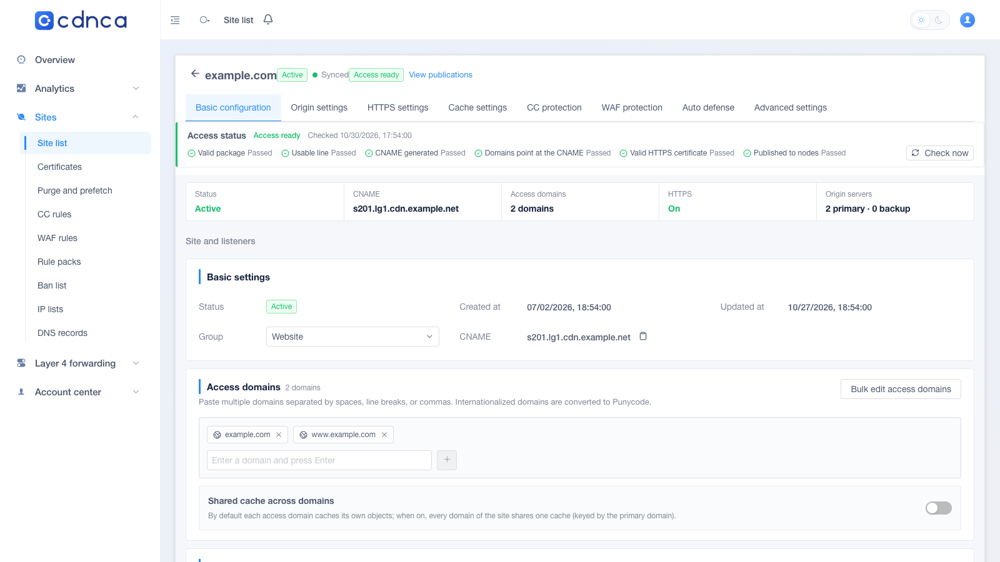 |
| **Multi-provider DNS** | **Analytics** |
| 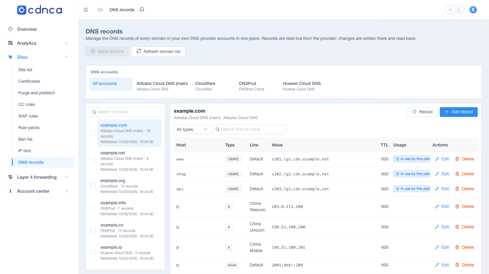 | 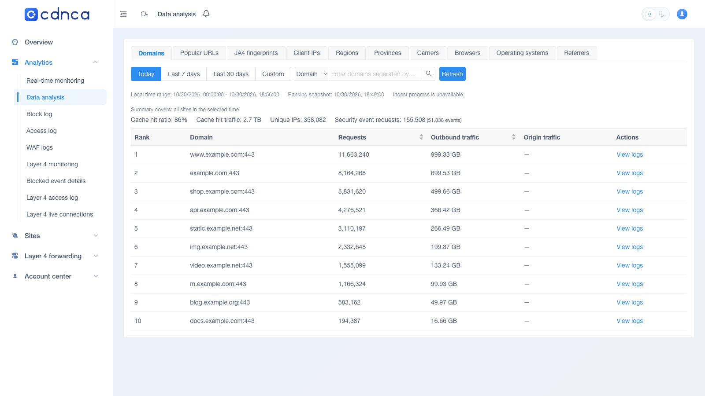 |

### Edge nodes

A node is the Go `edge-agent` plus the OpenResty edge runtime. The control plane only pushes configuration; traffic never passes through it.

- **The control plane compiles, nodes execute**: sites, certificates, cache, WAF / CC rules and layer-4 forwarding are compiled by the control plane and pushed to nodes, which report the version in effect; a node that fails to publish is disabled instead of serving traffic with stale configuration
- **Native runtime**: OpenResty 1.31.1.1 built from source with bundled patches (including JA4 fingerprinting and HTTP/3); node packages and container images come from the same build
- **Kernel-level protection**: XDP drops, per-site blocking, malformed TCP packet filtering and layer-4 guard rules stop attack traffic before it reaches OpenResty
- **Layer-4 forwarding**: TCP / UDP forwarding, port ranges, layer-4 session logs and live connections
- **Certificates loaded on demand**: no fixed limit on the node certificate store; automatic ACME HTTP-01 / DNS-01 issuance
- **Secure node enrollment**: one-time registration tokens and mutual TLS, node certificates bound to the node ID, no long-lived shared secrets; automatic reconnect with backoff when the gateway drops

Node status is shown in the admin console under the node list and real-time monitoring (see the screenshots above).

### Marketplace (nodes / plugins, **rolling out by version**)

- **Node marketplace**: other control planes can list node groups for supply; this site picks and subscribes by region, line and billing model (per day, per traffic, per bandwidth, 95th percentile, and so on), and top-ups go straight to the supplier's own payment account. Local node groups can be listed for supply as well
- **Plugin store**: rule packs, themes, DNS integrations and other plugins are fetched, bought and enabled here; each purchase is bound to this control plane and delivered through the officially signed per-installation artifact catalog
- The Community Edition registers its installation identity once, for free, before it can connect to the marketplace: `control-api community-register`

| Node marketplace | Plugin store |
|---|---|
| 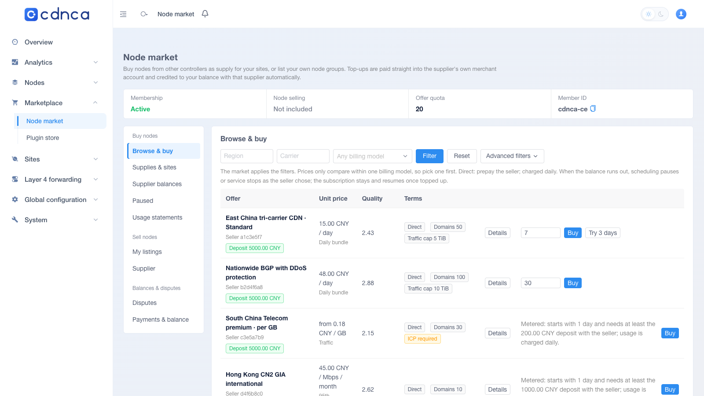 | 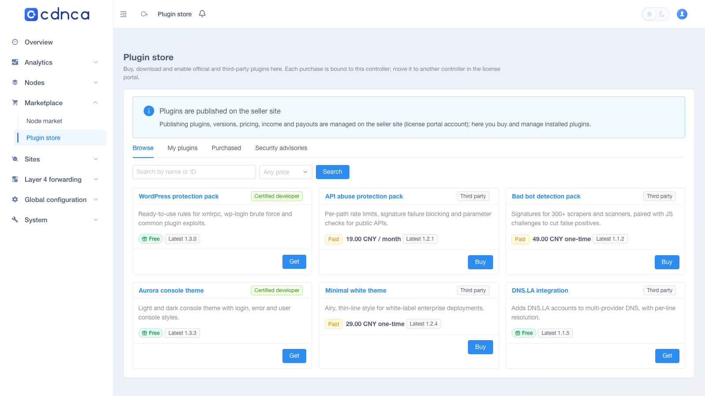 |

---

## What the Community Edition includes

- Sites, domains, certificates (including ACME HTTP-01/DNS-01), origins, caching, cache purge and prefetch
- Nodes, line groups, layer-4 forwarding, node monitoring
- Unified DNS management across multiple DNS providers
- WAF, CC protection, ACL, JS challenge, rule pack engine (your own rule packs), quick block
- Automatic site defense: CC auto-switching, automatic bans on WAF attacks and on WAF hits
- Tenant and user management, tickets, notifications
- Access logs, security logs, CC statistics and analytics (ClickHouse)
- Platform node security events (DDoS / layer-4 guard triggers) in the notification center
- Default theme
- Built-in free modules: SMS (Alibaba Cloud, SUBMAIL), email (Alibaba Cloud, SendGrid), ICP filing lookup, IP intelligence updates, dnspup probing
- Connects to the node and plugin marketplaces to buy rule packs, themes and plugins: register a free installation identity, and purchases are delivered and activated through the officially signed per-installation artifact catalog (**marketplace features roll out by version**)

## Community Edition and commercial edition

| | Community Edition | Commercial edition / paid modules |
|--|--------|-------------------|
| Open-source control plane / self-run nodes | ✅ | ✅ |
| No activation · no built-in billing | ✅ | — |
| Node marketplace (supplier subscriptions) | Rolling out by version | See product details |
| Plugin marketplace | Rolling out by version | See product details |
| Commercial modules / contract support | ❌ | ✅ |

The code for commercial modules is not in this repository. They include: intelligent automatic defense and adaptive WAF, automatic attack escalation, aggregated edge (third-party CDN integration), migration import; plans, balances, top-ups, orders, traffic packages, reselling, online payments and accounting integrations; the public website frontend, extra themes and white-labeling; the license service, the marketplace seller side, and online upgrades. Official rule sets (advanced CC rule groups, OWASP CRS profiles, in-house detection rule sets) can be bought on the plugin marketplace by Community Edition users.

The Community Edition suits individuals, small teams and CDN providers who want to get running and self-host first. For contract support or commercial modules, see the website (terms are subject to the official documentation).

The Community Edition does not connect to the license service: a community license is built into the program, with no limits on basic features or quotas. After installation the control plane sends one anonymous installation report (installation ID, version, node count, site count) and then one every 7 days; turn it off with `COMMUNITY_REPORT_URL=off`. There are no online upgrades: to upgrade, switch to the newer release package. The database schema is the same as the commercial edition, so moving to the commercial edition only takes a package change.

---

## Architecture (control plane + nodes)

| Layer | Description |
|------|------|
| **Control plane** | Written in Go; sites, nodes, policies and operations, plus the admin and user web consoles |
| **Node gateway** | Node enrollment and the gRPC channel |
| **Edge nodes (data plane)** | Go node agent + OpenResty edge runtime; caching, origin fetches and edge execution |

```
[ Operator ]
    │
    ▼
[ CDNCA control plane · Go ]
    │
    ├── Self-run edge nodes (Go)
    └── Node marketplace · supplier nodes (rolling out by version)
```

| Path | Contents |
|---|---|
| `services/control-api` | Control plane API, background jobs, database migrations |
| `services/agent-gateway` | Node enrollment and the gRPC channel |
| `agents/edge-agent` | Node agent (publishing, logs, telemetry, layer 4, kernel protection) |
| `edge/openresty` | Edge Lua modules and native patches |
| `apps/web` | Admin and user console frontends |
| `libs/` | Shared libraries (edge config, rule packs, license data structures, themes) |
| `proto/` | Protocols between the control plane, gateway and nodes |
| `docs/` | Architecture, protocol contracts, developer docs, ADRs |

---

## Installation (control plane to first site)

You need two x86_64 Linux servers (Ubuntu 24.04 official; Ubuntu 22.04, Debian 12/13 and Rocky/AlmaLinux/RHEL 9/10 compatible): one for the control plane and one for a node. Run everything as root. Click a screenshot to see it full size. Terminal screenshots follow the installer's real progress format with sample timings; the installers print their progress and prompts in Chinese.

### Step 1: Install the control plane

On the control plane server, download `install-control.sh` from the Community Edition release server and run it (the same files, with SHA256 sums and the release public key, are on [GitHub Releases](https://github.com/CDNCA/cdnca/releases/tag/v1.0.35-ce); for local package files, see the [installation guide](docs/installation-guide.md)):

```bash
curl -fsSLO https://www.cdnca.com/downloads/ce/install-control.sh
```

```bash
bash install-control.sh --release-server https://www.cdnca.com/downloads/ce
```

The installer runs 12 steps and asks for the console's public domain or IP, the HTTPS port (default 443), a certificate contact email, and the first administrator's username and password (not echoed). At the end it prints the console URL and the two node channel (Gateway) ports. **Open those two ports and 443 in your firewall / security group.**

<a href="docs/images/readme/en/install-1-control.png">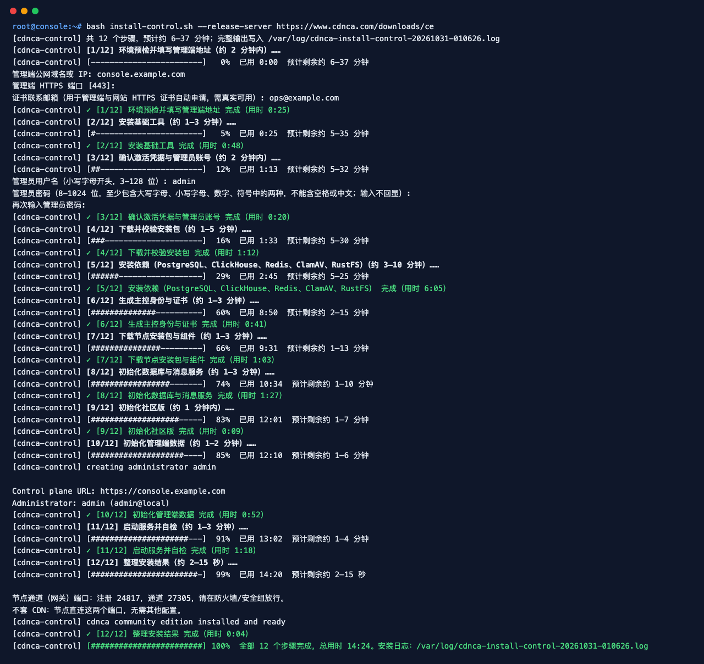</a>

### Step 2: Sign in to the console

Open `https://<console domain>/dashboard/` (printed at the end of the install) and sign in with the administrator account you just created.

<a href="docs/images/readme/en/install-2-login.png">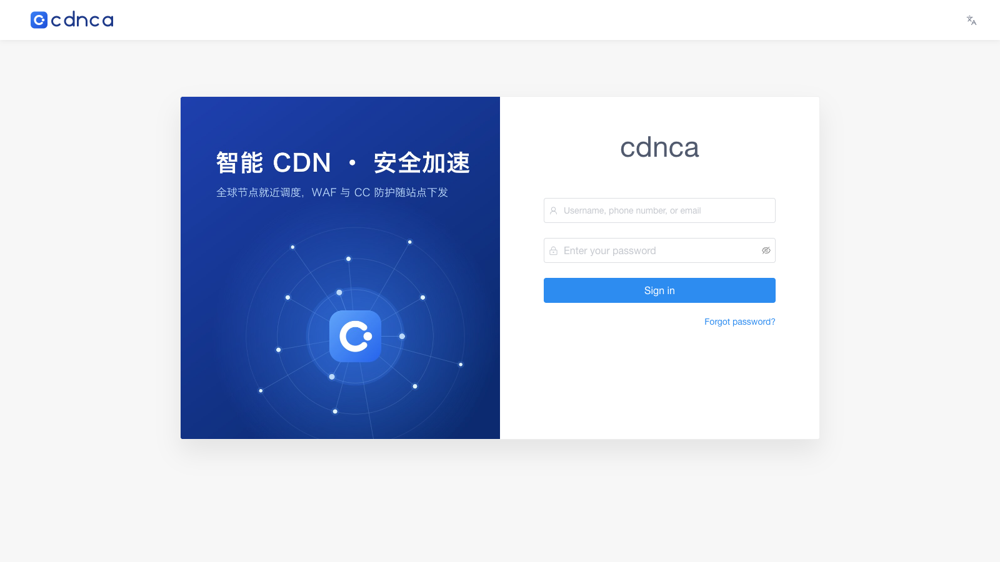</a>

### Step 3: Copy the node install command

Go to **Nodes → Node list**, click **Install node**, and copy the command in the dialog. Every node uses the same command and nothing needs to be added on the control plane first. The command carries the registration key: keep it private, and click **Reset registration key** if it leaks.

<a href="docs/images/readme/en/install-3-node-command.png">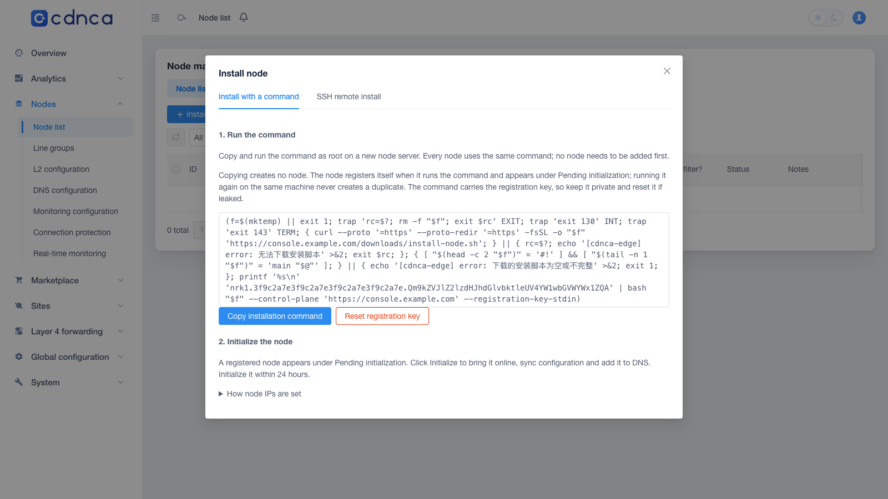</a>

### Step 4: Run it on the node server

Paste and run the command as root on the node server. The installer runs 8 steps and finishes once it has a session with the control plane Gateway. The agent starts OpenResty after the control plane sends the first configuration.

<a href="docs/images/readme/en/install-4-node.png">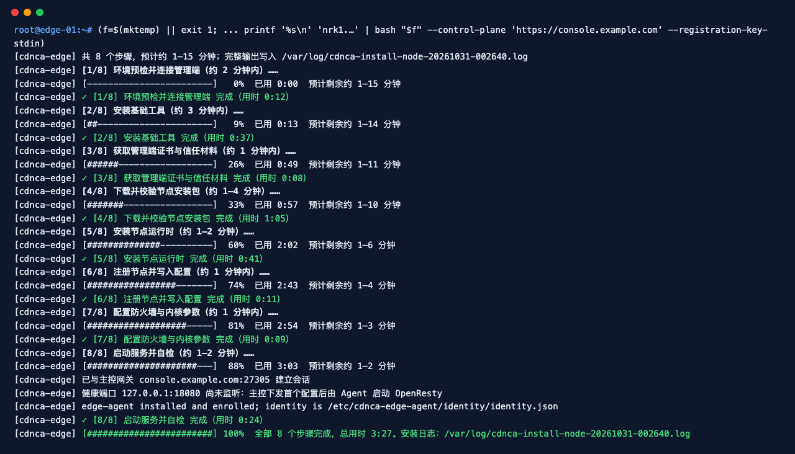</a>

### Step 5: Initialize the node

Back in **Node list**, open the **Pending initialization** tab. The node has registered itself there; click **Initialize**. It becomes active and starts syncing configuration. Initialize it within 24 hours.

<a href="docs/images/readme/en/install-5-node-init.png">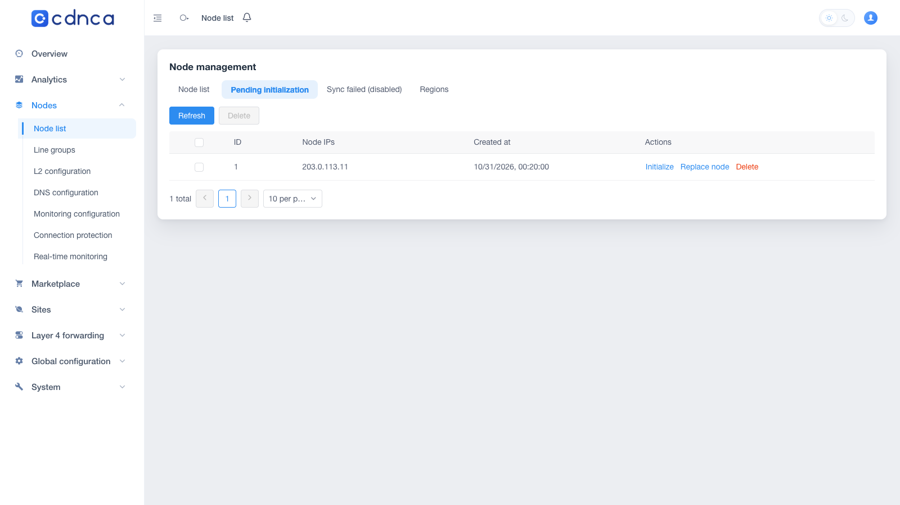</a>

### Step 6: Create a line group and make it the platform default

Go to **Nodes → Line groups**, click **Add Group**, add the node, and set the resolved value (the hostname visitors' CNAMEs point to). After saving, click **Set as Platform Default**. The Community Edition has no packages, so every site uses the platform default line group; without one, sites cannot be published.

<a href="docs/images/readme/en/install-6-line-group.png">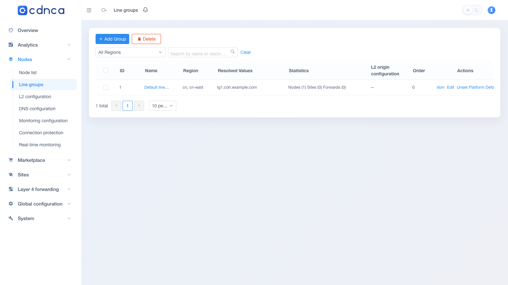</a>

### Step 7: Add a site

A site belongs to a user, so first create one under **System → Users → Add user**. Then go to **Sites → Site list**, click **Add site**, pick the owner user, enter the site domain and origin address, and click **Create site**.

<a href="docs/images/readme/en/install-7-site-create.png">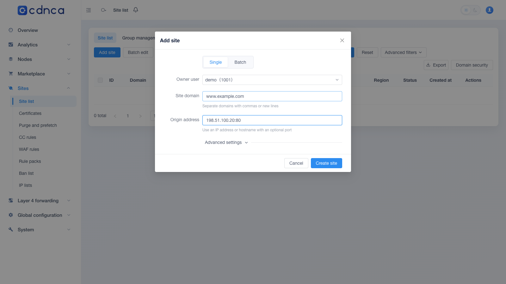</a>

### Step 8: Publish

Saving a site publishes it automatically; there is no manual step. Click **Manage** on the site in the site list, then **View publications** at the top of the edit page: the **Configuration publication** page shows the publication record and how many nodes received it.

<a href="docs/images/readme/en/install-8-publications.png">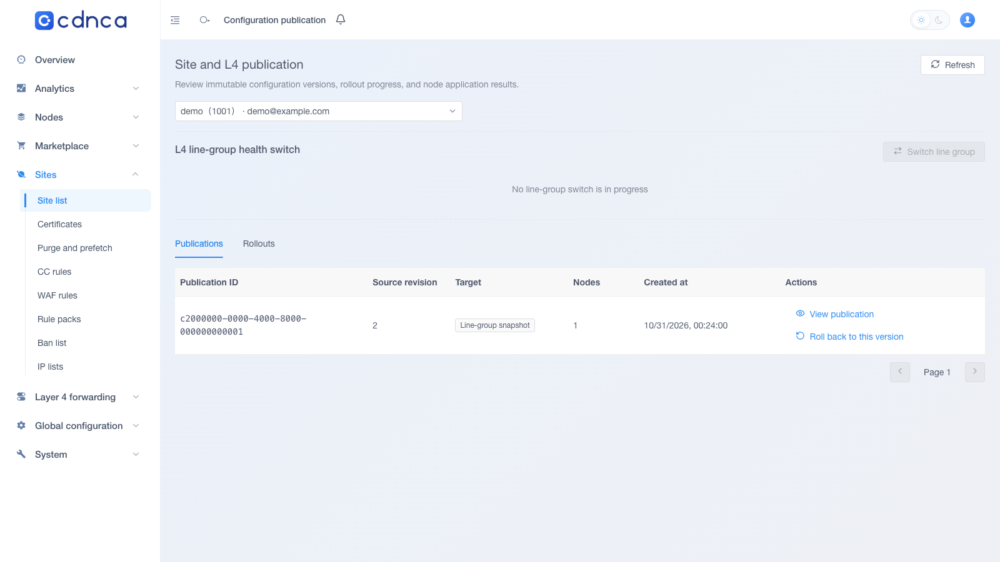</a>

### Step 9: Verify access

Once it is published, test through the node before touching DNS (replace the IP with your node's):

```bash
curl -I --resolve www.example.com:80:203.0.113.11 http://www.example.com/
```

Your origin's response (for example `HTTP/1.1 200 OK`) means the node is fetching from the origin. Then, at your DNS provider, CNAME the site domain to the CNAME shown in the site list. DNS is checked every 10 minutes; once it passes, the status shows **Access ready**.

<a href="docs/images/readme/en/install-9-site-ready.png">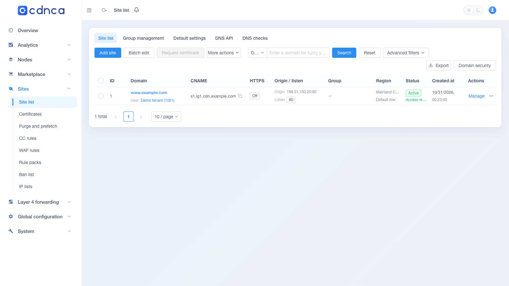</a>

---

## Quick start

Release packages are published on [GitHub Releases](https://github.com/CDNCA/cdnca/releases) and at `https://www.cdnca.com/downloads/ce/`. See [cdnca.com](https://cdnca.com) for details.

A fresh single control plane install uses `scripts/install-control.sh` (run as root; `--help` lists the options) and needs no activation code. The control plane and node packages are downloaded from the release server given by `--release-server` and their signatures are verified; you can also point `--native-package-file` / `--native-trust-file` at local files. Steps are in the [installation guide](docs/installation-guide.md).

**Path A · Your own nodes**

1. Deploy the Community Edition control plane
2. Install and register at least one node of your own
3. Add a site and check caching and origin fetches

**Path B · Node marketplace subscription (asset-light)**

1. Deploy the Community Edition control plane
2. Register this installation once with a free portal account: `control-api community-register --account <portal account> --password-stdin`
3. Pick a supplier on the node marketplace and subscribe (**marketplace features roll out by version**), then bind a domain and check that requests hit

---

## Local development

Requirements: Docker (with Compose v2), GNU Make, Go (see `go.work`), Node.js and pnpm, Bash, curl, OpenSSL.

```sh
make help
make up
make status
```

`make up` starts PostgreSQL, Redis, ClickHouse, NATS JetStream, database migrations, `control-api`, `agent-gateway`, Mailpit and the admin web console. Local key material is generated outside the repository. To start only the infrastructure: `make infra-up`, `make infra-test`.

Run the tests:

```sh
go -C services/control-api test ./...
go -C agents/edge-agent test ./...
pnpm -C apps/web test
```

Some integration tests need a local PostgreSQL and are skipped without one.

Docs: [Developer guide](docs/developer/README.md) · [Protocol contracts](docs/protocol-contracts.md) · [OpenAPI](api/openapi/v1) · [Architecture decision records](docs/adr)

---

## Contributing

Issues, discussions and documentation improvements are welcome. Contribution guidelines will grow with the Community Edition repository.

Before submitting:

- Public wording about the node or plugin marketplace must include **"marketplace features roll out by version"**
- Major behavior and license changes need maintainer approval

---

## License

This repository is licensed under the **GNU Affero General Public License v3.0 (AGPL-3.0)**; see [`LICENSE`](./LICENSE) for the full text.

In short: you may use, modify and redistribute it freely; if you offer a modified version as a network service, AGPL-3.0 section 13 requires you to provide its complete corresponding source code to its users.

---

## Links

- Website: https://cdnca.com
- Repository: https://github.com/CDNCA/cdnca
